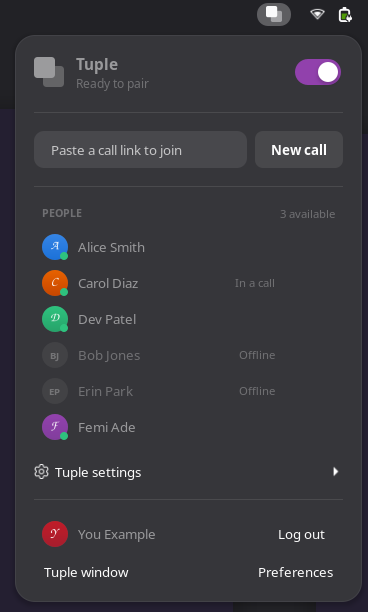
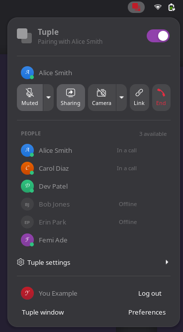
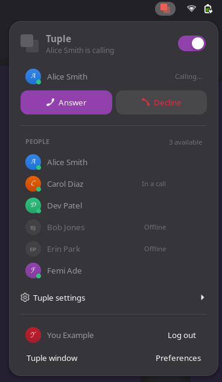

# Tuple for GNOME

A top-bar indicator and menu for [Tuple's Linux client](https://tuple.app/linux/)
on GNOME Shell 51. Tuple for Linux is a command-line tool; this gives it a
home in your top bar.

It's a fork and port of Benjamin Sehl's
[omarchy-tuple](https://github.com/benjaminsehl/omarchy-tuple), a plugin for
Omarchy's Quickshell bar on Hyprland. The port keeps its log parser, design
rules and helper scripts, and replaces the Omarchy/Hyprland side with GNOME
Shell's own. It also targets the newer **v2026_10_23.0** client, whose CLI
changed a lot (see below).

<table>
  <tr>
    <td></td>
    <td></td>
    <td></td>
  </tr>
  <tr>
    <td align="center"><sub><b>Ready to pair.</b> One field starts or joins a call.</sub></td>
    <td align="center"><sub><b>In a call.</b> The controls show their state.</sub></td>
    <td align="center"><sub><b>Ringing.</b> Who's calling, and Answer.</sub></td>
  </tr>
</table>

<sub>Screenshots use the built-in demo data (`tuple-shell demo <state>`).</sub>

## What you get

- **Top-bar mark:** Tuple's two squares in the panel colour. It's dimmed with a
  slash when Tuple is off, gets a red dot when you're logged out, turns red
  during a call (darker red when muted), gets a dot while you share, and
  pulses while a call rings.
  - Left click opens the menu.
  - Right click mutes or unmutes in a call, or answers a ringing call.
  - Middle click shares or unshares in a call, or refreshes otherwise.
- **Menu:**
  - an on/off switch for the daemon
  - browser login with an authorization-code field
  - one field that starts a new call (and copies its link) or joins a pasted
    link; a link on the clipboard is filled in for you
  - in-call controls: mute, share, camera, copy link, end. The Mic and Camera
    tiles have a ▾ that picks the device.
  - **Camera** works with sharing, because Tuple for Linux can't send webcam
    video at all. While you share, Camera shows or hides your camera as a tile
    on your screen, which they see in the share. When you're not sharing,
    Camera says so and offers **Share with camera** instead of opening a tile
    only you could see. The tile closes when the share stops.
  - who's in the call, and a "Their screen" row (View, and a Control switch
    for draw vs. drive)
  - people: favourites, then recent, then available, with search across the
    whole directory, a ★ toggle, and one-click calling for anyone online
  - all of `tuple settings`
  - you (picture and name) with Log out; Tuple's own window and Preferences
- **Profile pictures** for people in the list, in your call, ringing you,
  and in their notifications, with initials for anyone without one. They come
  from Gravatar, which is where Tuple's own `avatar_url` fields point: the
  address is the MD5 of the email, so Gravatar sees those hashes, as it does
  with Tuple's own apps. Only people the menu shows are fetched, a few at a
  time, in the background. They're cached in `~/.cache/tuple-gnome/avatars`
  for a week (a "no picture" answer for a day). Turn them off in Preferences.
- **Notifications** (GNOME's own, with buttons): incoming call
  (Answer/Decline), join request (Show), someone joined, "everyone left"
  (End call), and no answer.
- **Window placement** (Mutter instead of `hyprctl`):
  - Tuple's prompts are centred, and incoming-call and join-request prompts
    stay on top.
  - Their webcam and your camera tile start as equal squares in the
    bottom-right corner, on every workspace, without taking focus. Once you
    move or resize one, it stays where you put it.
  - Your camera tile has no title bar (GNOME draws none for it), so it takes
    the mouse itself:
    - drag it to move it
    - scroll to resize it
    - double-click to switch between small and large
    - press `q` or Esc to close it

    Super+drag works too.
- **The overlay that blacks out the screen:** while you share, Tuple opens a
  drawing overlay. GNOME has no layer-shell, so it falls back to an opaque,
  full-screen window that covers everything and takes every click. The
  extension switches Tuple's `overlay` setting off, and if the overlay ever
  shows anyway, minimizes it at once. Guests' drawings then don't show on your
  own screen; everything else about sharing works. To keep the overlay, turn
  "Keep Tuple's drawing overlay off" off in Preferences.
- **Shortcuts that work over anything:** Super+Ctrl+Esc stops sharing (and
  closes your camera tile), even with a full-screen window in the way.
  Super+Ctrl+T opens the menu. Change either in Preferences.
- **Performance power mode during calls:** Tuple decodes video in software,
  so a call is CPU-bound. On Balanced, a hybrid CPU may put that on its slow
  cores. The extension holds Performance for the length of a call through
  power-profiles-daemon, and lets go when it ends. Turn this off in
  Preferences.
- **Keys in the menu:** arrows and Tab move between controls. The letter
  shortcuts work when you're not typing in a field:
  - `m` mute, `s` share, `v` camera
  - `e` end or decline, `a` answer
  - `n` new call, `c` copy link, `i` join field, `/` search
  - `f` favourite the focused person
  - `o` on/off, `r` refresh
  - `M` / `V` choose a mic / camera
- **`tuple-shell`** drives it from a terminal or a GNOME custom shortcut:

  ```bash
  tuple-shell toggle | toggleMute | toggleShare | toggleCamera | shareWithCamera | stopSharing | end | answer | newCall | joinClipboard | copyLink | on | off
  tuple-shell join https://tuple.app/c/xyz
  tuple-shell cameras | camera <name|number|default> | mics | mic <...> | deviceMenu mic|camera
  tuple-shell status          # JSON: daemon, loggedIn, call, peers, muted, sharing, …
  tuple-shell windows         # Tuple's windows as Mutter sees them (role, X11/Wayland, size, …)
  tuple-shell demo call       # canned states: call | idle | viewing | incoming | login | stopped | off
  ```

  For a shortcut, go to Settings → Keyboard → Custom Shortcuts and add, e.g.,
  `tuple-shell toggleMute` on Super+Ctrl+M.

## Requirements

- GNOME Shell 51 (Wayland or X11). Other versions aren't tested, and
  `metadata.json` says so.
- The Tuple CLI from [tuple.app/linux](https://tuple.app/linux/) (tested
  with v2026_10_23.0), in `~/.local/bin` or `~/bin` or on `PATH` (or set its
  path in Preferences), and a Tuple account
- `jq`: the people list is filtered with it, outside the shell
- Optional:
  - `pactl` (PipeWire/PulseAudio) for choosing a mic
  - `v4l2-ctl` (v4l-utils) for the camera list
  - `mpv` for your camera tile
  - `ffmpeg` and the `v4l2loopback` kernel module for the virtual camera
    (see [Your webcam](#your-webcam))

  Everything else works without them.

## Install

```bash
git clone https://github.com/ericflo/gnome-tuple.git ~/Projects/gnome-tuple
cd ~/Projects/gnome-tuple
./install.sh      # links tuple@ericflo into ~/.local/share/gnome-shell/extensions,
                  # compiles the schema, links tuple-shell into ~/.local/bin, enables it
./uninstall.sh    # undoes all of that
```

GNOME Shell on Wayland only discovers new extensions when it starts. After the
first install, or after changing the code, log out and back in. Then click
the Tuple mark, switch Tuple on, and choose **Log in**.

## Your webcam

**Tuple for Linux can't send your webcam yet**, and nothing outside its binary
can make it — the camera-capture code is an unimplemented stub and the daemon
refuses the request, both inside the closed `tuple` binary.
[`docs/webcam-sending.md`](docs/webcam-sending.md) has the full why.

So on a call, the only way the other person sees your camera today is **inside
your screen share**: the Camera button puts your camera on your shared screen
as a tile (that's why Camera and sharing go together). No extra setup for that.

For the day Tuple does implement sending — and for using your camera in other
apps (browser calls, OBS) right now — the repo stages a **virtual camera**: a
stable device called "Tuple Camera" fed by your real one. It's optional. To set
it up:

```bash
# one-time, as root: create the "Tuple Camera" device
sudo modprobe v4l2loopback video_nr=42 card_label="Tuple Camera" exclusive_caps=1
# persist it across reboots
echo 'options v4l2loopback video_nr=42 card_label="Tuple Camera" exclusive_caps=1' | sudo tee /etc/modprobe.d/tuple-camera.conf
echo v4l2loopback | sudo tee /etc/modules-load.d/tuple-camera.conf
```

(`v4l2loopback` comes from the `v4l2loopback-dkms` package; `tuple-virtualcam
--setup` prints these same lines.) Then, whenever you want it live:

```bash
tuple-virtualcam        # films your real camera into "Tuple Camera", un-mirrored
```

The day Tuple ships webcam capture, you point it at "Tuple Camera" and you're
framed and ready. Until then it changes nothing on a Tuple call.

## How the v2026_10_23.0 client differs from what omarchy-tuple targeted

Tuple replaced the original Linux commands with its cross-platform CLI.

- **Live state:** `tuple state follow --format json` streams a summary
  whenever it changes. It covers whether you're signed in, whether you're in a
  call and with whom, mute, and connection health. It's the main feed now, so
  mute is no longer guessed from replies.
- **Renamed commands:**

  | Before | Now |
  | --- | --- |
  | `on` / `off` | `start` / `stop` |
  | `ls` | `contacts list --format json` |
  | `call` (interactive prompt) | `call start <person>` (any contact, not just favourites; exits 0 when answered, 2 when not) |
  | `join` / `end` | `call join` / `call leave` |
  | `mute` | `call mute` / `call unmute` |
  | — | `call accept` (answers without Tuple's window) |

  `new`, `share`, `unshare`, `ui`, `settings` and `set` still work but are
  deprecated.
- **Socket:** the daemon listens on `$XDG_RUNTIME_DIR/tuple-0` instead of
  `@tuple-daemon`, and still starts itself for almost any command. So the
  extension checks `/proc/net/unix` and only follows state while the daemon is
  up. Otherwise "off" wouldn't stay off.
- **Daemon log:** `~/.local/share/tuple/0/log.txt` keeps its format. The
  original's log reducer (`model.js`) still supplies what the summary lacks: a
  call ringing in, your screen share, their screen and webcam, and join
  requests.

- **Big directories:** `tuple contacts list --format json` prints the whole
  company directory (~1.7MB for 8k people), and most of it reports presence as
  "unknown". The extension never parses that in the shell, because doing so
  stalled the desktop. `bin/tuple-contacts` filters it to favourites, recents
  and whoever's online, and search uses Tuple's own `contacts list -q`.

## Known gaps

- **Not yet seen live:** these work against a real account and directory:
  - signing in
  - on/off
  - the people list and search
  - profile pictures

  A real call has shown screen sharing, their screen and their webcam, which
  is where the problems above came from. The fixes are tested with real input
  in a headless GNOME Shell (`tests/headless.sh --stage`), with stand-ins for
  Tuple's windows. Not yet seen in a real call:
  - a ringing incoming call
  - mic routing
  - the fixes themselves

  `tuple-shell status` shows what the extension currently believes.
- **Their screen on GNOME:** guests can watch but not drive your screen.
  That's Tuple's limitation on GNOME/KDE Wayland, not this extension's.
- **No webcam sending or input selection:** Tuple for Linux v2026_10_23.0
  can't send your webcam (`WebcamCapturerAdapter: TODO: implement Start`) or
  choose a mic. Your camera reaches them only as a tile inside your screen
  share (see [Your webcam](#your-webcam) and
  [`docs/webcam-sending.md`](docs/webcam-sending.md)). A chosen mic is applied
  by moving Tuple's recording stream (`bin/tuple-mic-route`).
- **Video is decoded on the CPU:** Tuple's only codecs are libvpx VP8/VP9 in
  software, and it draws video through XWayland. Both get more expensive as
  the window gets bigger and as their screen's resolution goes up, which is
  why a large "Their screen" window can stutter. A smaller window helps, and
  so does the Performance power mode (on by default during calls). There's
  no GPU path in this build of Tuple.
  - `~/.local/state/tuple-gnome/perf.log` samples a call every 20 seconds:
    Tuple's busiest threads, the power mode, and the window sizes. That shows
    which part is busy.
- **Decline:** Tuple has no decline command, so Decline runs `call leave`.

## Develop

```bash
node --test tests/*.test.mjs               # model.js: parsers + log reducer
gjs -m tests/live.js status|watch|on|off|contacts   # service.js against the real daemon, no shell needed
gjs -m tests/lag.js [query|--idle 60]      # main-thread cost of a refresh, a search, or idling
gjs -m tests/shell-lag.js 150              # stalls in the running GNOME Shell
gjs -m tests/avatars.js                    # fetch your people's pictures into a throwaway cache
tests/headless.sh /tmp/shots [dark|light]  # a throwaway headless GNOME Shell: screenshots of every demo state
tests/headless.sh --clicks                 # …and real pointer clicks on its switches
tests/headless.sh --stage /tmp/stage       # …and the camera flow and call stage, with real drags,
                                           # scrolls, a fake fullscreen overlay and the shortcuts
```

The headless runs have their own D-Bus session, dconf, XDG directories and
runtime directory, so they don't touch your desktop.

Files in `tuple@ericflo/`:

- `model.js`: pure parsing and the state reducer; no GNOME APIs. Adapted
  from the original's `Model.js`.
- `service.js`: the daemon probe, state and log followers, and command
  runner. Gio/GLib only.
- `extension.js`: the indicator, menu, notifications, clipboard and D-Bus
  interface.
- `windows.js`: placement of Tuple's windows and the camera stage.
- `avatars.js`: profile pictures (Gravatar, async fetch and disk cache).
- `prefs.js`, `schemas/`: preferences.
- `bin/`:
  - `tuple-selfcam`: your camera tile
  - `tuple-cameras`: the list of real cameras to film
  - `tuple-virtualcam`: feed a real camera into the "Tuple Camera"
    v4l2loopback device (staging for webcam sending)
  - `tuple-contacts`: filter the directory to the people the menu shows
  - `tuple-mic-route`: mic routing
  - `tuple-perf`: call performance samples
  - `tuple-archive`: rolling copies of the daemon log in
    `~/.local/state/tuple-gnome/`
  - `tuple-shell`: the IPC client

## Credits

The original, [omarchy-tuple](https://github.com/benjaminsehl/omarchy-tuple),
is by Benjamin Sehl. Its reverse-engineering of the Linux client, the log
parser (`model.js`), the call-log fixtures in `tests/`, and the design rules
all carry over. This project isn't affiliated with Tuple.

MIT, like the original. See LICENSE.
